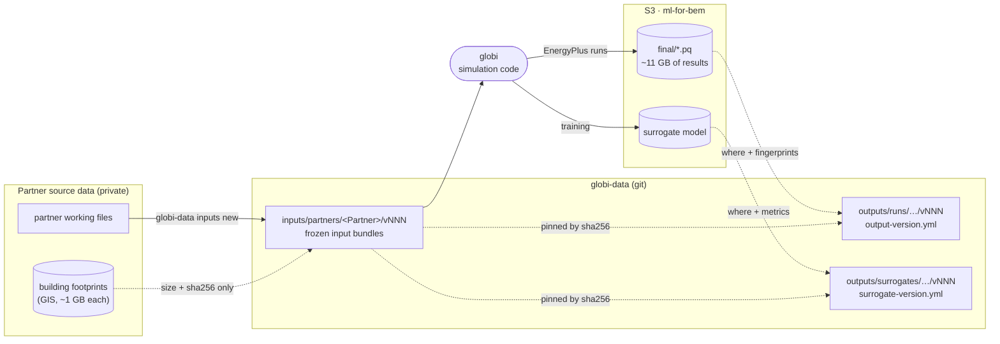

# Data & outputs

globi runs the simulations. Their input files and the records of their results
are kept in a separate repository,
[globi-data](https://github.com/MITSustainableDesignLab/globi-data). This
section explains how that repository is organized and shows what is in it.
Most pages here are **generated from globi-data at build time**, so they show
the data as it stands rather than a copy that can drift.

## Where everything lives



Solid arrows move files. Dashed arrows record facts about files that stay
where they are.

Two things decide where a file lives: whether it may be published, and how
big it is. Building footprints are partner data and are not published.
Simulation results are too large for git. For both, globi-data records a
fingerprint (sha256), which is enough to prove later that a result came from
particular inputs without publishing the inputs themselves.

| What                                                                                | Stored in            | Size                 | Versioned by                                                      |
| ----------------------------------------------------------------------------------- | -------------------- | -------------------- | ----------------------------------------------------------------- |
| Input bundles (component library, semantic fields, component map, weather, configs) | globi-data `inputs/` | a few MB per partner | `inputs/partners/<Partner>/vNNN/`                                 |
| Building footprints (GIS)                                                           | not published        | ~1 GB per partner    | size and sha256 recorded in each input version's `external_files` |
| Simulation results (parquet)                                                        | S3                   | ~11 GB in total      | recorded in `outputs/runs/…/vNNN/output-version.yml`              |
| Trained surrogate models                                                            | S3                   | varies               | recorded in `outputs/surrogates/<Partner>/vNNN/`                  |

## Pages in this section

- [**Output structure**](outputs-structure.md) explains how results are
  organized, what each output record contains, and how results are marked
  stale.
- [**Run catalog**](runs/index.md) lists every recorded run, with a coverage
  matrix, a timeline, and a page per partner.
- [**Results status**](status.md) shows which results still match the current
  inputs.
- [**Surrogate models**](surrogates.md) lists the trained surrogates and their
  feature contracts.
- [**Input bundles**](inputs.md) shows the current input version for each
  partner.
- **Reference** holds globi-data's own manifest schema and how-to guides,
  pulled in unchanged.

## Building these pages

The generated pages come from a local checkout of globi-data. The build looks
for one at `$GLOBI_DATA_ROOT`, then `../globi-data` and `../../globi-data`
(relative to `mkdocs.yml`), then `.globi-data`:

```bash
export GLOBI_DATA_ROOT=~/globi-data
make docs            # uv run mkdocs serve
```

If no checkout is found, the build still succeeds and each generated page says
the data was missing. Set `GLOBI_DATA_REQUIRED=1` to make that an error
instead. The generator is
[`mkdocs_hooks/globi_data.py`](https://github.com/mitsustainabledesignlab/globi/blob/main/mkdocs_hooks/globi_data.py).
