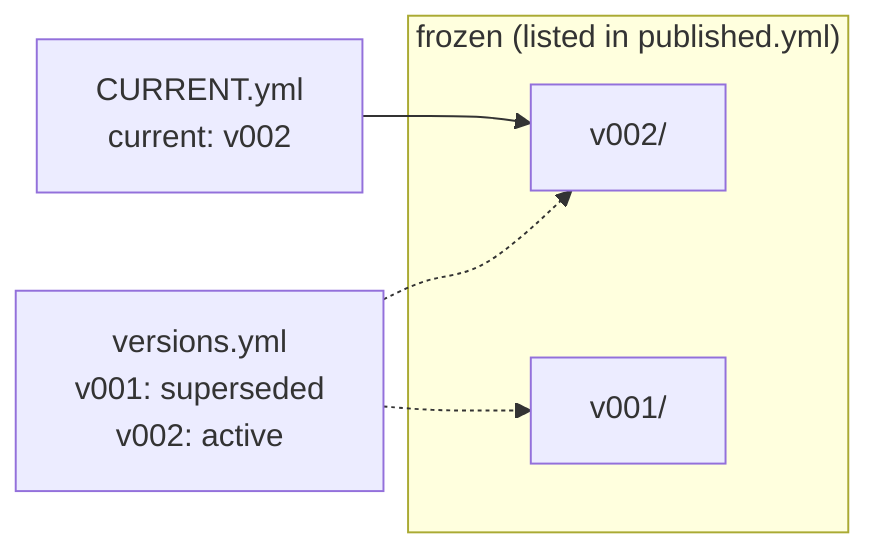
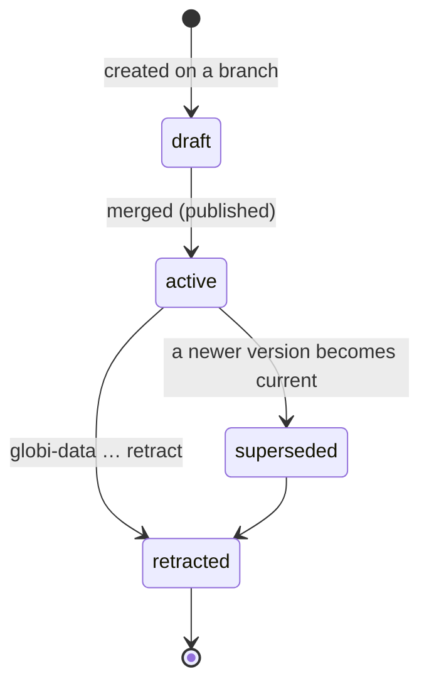
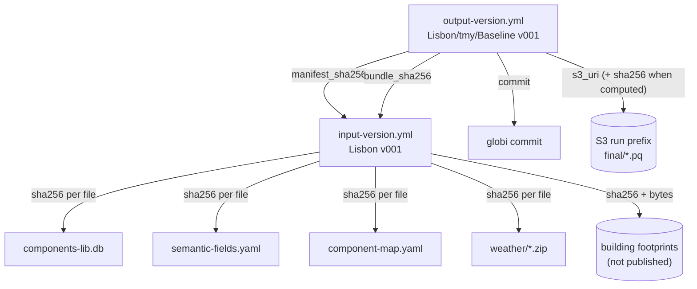
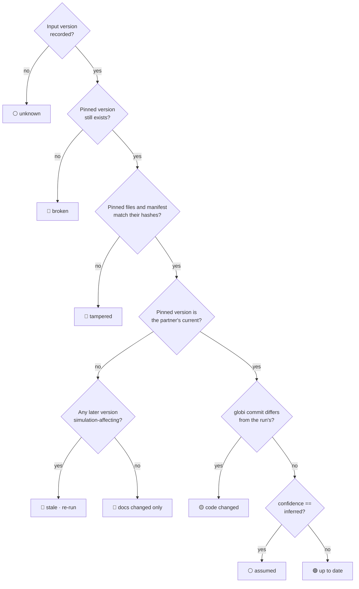

# Output structure

Every simulation run leaves two things behind:

1. **The results.** These are parquet files in S3, written by scythe under a
   run prefix.
2. **A record of the results.** This is a small YAML file in globi-data. It
   says where the parquet files are and exactly which inputs and code produced
   them.

This page covers the record: how it is laid out, what it contains, and how it
is used to tell whether results are still current.

## The directory tree

```
outputs/
├── README.md                  ← generated catalog
├── STATUS.md                  ← generated: which results are stale
├── index.yml                  ← generated: machine-readable catalog
├── runs/
│   └── <Partner>/
│       └── <weather>/         ← tmy | ftmy
│           └── <Scenario>/    ← e.g. Baseline, Retrofit, BAU, withAC
│               ├── CURRENT.yml        ← which version is current (mutable)
│               ├── versions.yml       ← status of every version (mutable)
│               └── v001/              ← frozen once published
│                   ├── output-version.yml
│                   └── README.md
├── batches/
│   └── <Batch>/vNNN/          ← run families too big to list one by one
└── surrogates/
    └── <Partner>/
        ├── versions.yml
        └── vNNN/
            ├── surrogate-version.yml
            └── transforms.yml
```

Each level of `runs/` is one axis of the experiment design:

| Level        | Meaning                                                     | Values today                                                                       |
| ------------ | ----------------------------------------------------------- | ---------------------------------------------------------------------------------- |
| `<Partner>`  | A region, with its own input bundle                         | Ahmedabad, Lisbon, Manchester, Nairobi, Sao_Paulo_Bela_Vista, Singapore, Trondheim |
| `<weather>`  | Which weather file drove the run                            | `tmy` (current climate), `ftmy` (future, 2050)                                     |
| `<Scenario>` | The partner's scenario, as named in its experiment manifest | one `baseline` and one `alternative` per partner                                   |
| `vNNN`       | The globi-data version of this record                       | `v001` for everything backfilled so far                                            |

`<Partner>/<weather>/<Scenario>` is called the **experiment**, and it matches
the experiment name used when the run was submitted. Every experiment has its own
`CURRENT.yml` and `versions.yml`, so a single run can be re-done or retracted
without touching its neighbors.

!!! info "Why weather is a directory for runs but not for surrogates"
A simulation run uses exactly one weather file, so weather is one of the
axes that tell runs apart. A surrogate takes weather as a model _input_
and covers current and future climate in one model, so
`outputs/surrogates/<Partner>/vNNN/` has no `<weather>` level.

## Mutable pointers, frozen versions

The same rule applies to inputs, outputs and surrogates. A `vNNN/` directory
is never edited after it is published. Everything that can change sits next
to the version directories, not inside them.



`CURRENT.yml` is a file rather than a symlink, because symlinks break on
Windows checkouts and show up as a 20-byte text blob on GitHub. A consumer
resolves versions in this order: an explicit `vNNN`, then `CURRENT.yml`, then
the highest version present (with a warning).

A version's `status` in `versions.yml` follows this lifecycle:



Retracting a version only changes `versions.yml`. The frozen directory stays
readable, so anything that pinned it can still be traced.

## From an output record to the files in S3

The record points into S3. It does not reconstruct the location from
configuration. The path in S3 mirrors the experiment name, followed by two
levels that scythe adds:

```text
s3://ml-for-bem/globi-partners/Lisbon/tmy/Baseline/v1.0.0/2026-06-08_13-37-12/final/EnergyAndPeak.pq
     └───┬────┘ └─────┬──────┘ └────────┬────────┘ └─┬──┘ └────────┬────────┘       └─────┬─────┘
      bucket          │            experiment        │       run_timestamp                │
                bucket_prefix                     version                            result_key
```

| Segment               | Field in `output-version.yml`               | Set by                                                                                                                                 |
| --------------------- | ------------------------------------------- | -------------------------------------------------------------------------------------------------------------------------------------- |
| `ml-for-bem`          | `provenance.storage.bucket`                 | scythe storage config                                                                                                                  |
| `globi-partners`      | `provenance.storage.bucket_prefix`          | parsed from the observed URI                                                                                                           |
| `Lisbon/tmy/Baseline` | `experiment`                                | the experiment name, same as the directory in globi-data                                                                               |
| `v1.0.0`              | `version` / `provenance.run.scythe_version` | scythe, per submitted run                                                                                                              |
| `2026-06-08_13-37-12` | `run_timestamp`                             | scythe, when the run was submitted                                                                                                     |
| `final/<key>.pq`      | `result_files[].s3_uri`                     | one parquet per result key: `EnergyAndPeak`, `EnergyAndPeakAnnual`, `BasicOverheating`, `ExceedanceDegreeHours`, `HeatIndexCategories` |

Everything up to the timestamp is `provenance.storage.run_prefix`.

!!! warning "Two different \"versions\""
In `output-version.yml`, **`version`** is the _scythe run version_
(`v1.0.0`), part of the S3 path. The globi-data version of the record is
**`output_version`** (`v001`). The field name `version` is fixed for
compatibility with the legacy `latest-results --yaml-dir` export.

!!! warning "`bucket_prefix` comes from the URI, never the environment"
The recorded URIs use `globi-partners`, while the run environment
currently sets `SCYTHE_STORAGE_BUCKET_PREFIX=globi`. A URI rebuilt from the environment
would point to the wrong place, so the prefix is always parsed from the
URI that was actually observed.

## Anatomy of `output-version.yml`

The file has three parts: a block kept for compatibility with existing tools,
the version envelope, and the provenance.

```yaml
schema_version: 1
kind: output-version

# ── legacy-compatible block: what `latest-results --yaml-dir` writes ──
experiment: Lisbon/tmy/Baseline
version: v1.0.0 # (1)!
run_timestamp: 2026-06-08_13-37-12
results: # (2)!
  EnergyAndPeak: s3://ml-for-bem/globi-partners/Lisbon/tmy/Baseline/v1.0.0/2026-06-08_13-37-12/final/EnergyAndPeak.pq
  # …one entry per result key

# ── version envelope ──
output_version: v001 # (3)!
parent_version: null
status: active
summary: Backfilled from latest-results.csv; first recorded results for this experiment.
partner: Lisbon
weather: tmy
scenario_kind: baseline # (4)!
scenario_value: Baseline

# ── provenance: what produced these numbers ──
provenance:
  input:
    version: v001
    manifest_path: inputs/partners/Lisbon/v001/input-version.yml
    manifest_sha256: 2a587ca3… # (5)!
    bundle_sha256: f6bb368c…
    confidence: inferred # (6)!
    gis_file: { sha256: 9a544bc4…, bytes: 1129469887 }
  code:
    globi: { commit: c2d84e47…, describe: v0.2.0-96-gc2d84e4 }
    scythe_engine: null
    python: 3.13.12
  storage:
    bucket: ml-for-bem
    bucket_prefix: globi-partners
    run_prefix: s3://ml-for-bem/globi-partners/Lisbon/tmy/Baseline/v1.0.0/2026-06-08_13-37-12
  run:
    scythe_version: v1.0.0
    run_timestamp: 2026-06-08_13-37-12
    hatchet_workflow_run_id: null # (7)!

result_files: # (8)!
  - result_key: EnergyAndPeak
    s3_uri: s3://…/final/EnergyAndPeak.pq
    bytes: null
    sha256: null
    sha256_source: none
totals: { file_count: 5, bytes: 0 }
```

1. The **scythe run version**, part of the S3 path. It is not the globi-data version.
2. A flat `key → URI` map, identical to what existing consumers read.
3. The globi-data version of this record, matching the `vNNN/` directory it lives in.
4. `baseline` or `alternative`. `scenario_value` is the partner's own name for the scenario.
5. The sha256 of the pinned `input-version.yml`'s bytes. If that file changes, these results are flagged **tampered**.
6. `exact` means recorded when the run was submitted, `inferred` means assumed during backfill, and `unknown` means nothing was pinned. `inferred` is never upgraded to `exact` without evidence.
7. Filled in for runs recorded when they are submitted. Backfilled records leave it null.
8. One entry per parquet file. `sha256_source: computed` means the bytes were hashed. `none` means the fingerprint has not been computed yet.

### What is pinned, and how

An output record points at an input version, and the input version points at
its files. Each link is a hash, so any change along the chain can be detected:



- **A file's `sha256`** detects an edit to that file.
- **`bundle_sha256`** covers every simulation-affecting file together. It is
  the bundle's content identity, and it leaves out READMEs, so fixing
  documentation cannot invalidate results.
- **`manifest_sha256`** covers the bytes of `input-version.yml` and is what
  an output record pins.

## Staleness: is this result still current?

`globi-data status` checks every experiment's current output version and
writes the verdict to `outputs/STATUS.md`. The checks run in this order, and
the first one that matches decides the verdict:



The `impact` field on each input version makes this work. A version that only
touches documentation is classified `metadata-only`, and moving past it never
marks results stale. Without that field, a typo fix in a README would flag
every experiment for a re-run.

The current verdicts are on the [Results status](status.md) page.

## Batches

Some run families have too many members to give each its own directory. MA,
for example, allocates about 355 building specs to each of about 1,600 census
tracts. These use `outputs/batches/<Batch>/vNNN/` with the same version
envelope and provenance, but `results:` is replaced by a `result_index` that
points at a `results.csv`, plus an `allocation` block that describes how specs
were split.

## Surrogates

A trained surrogate is recorded like a run, with two differences. Its record,
`surrogate-version.yml`, describes a **model contract** rather than a list of
result files. And the contract itself, `transforms.yml`, is kept in git, where
anyone can read it without credentials:

| Part                  | Where                 | What it says                                                                                                            |
| --------------------- | --------------------- | ----------------------------------------------------------------------------------------------------------------------- |
| `model`               | S3 (`model.s3_uri`)   | backend (`xgb`/`lgb`/`nn`), format, hyperparameters                                                                     |
| `transforms.yml`      | git, pinned by sha256 | ordered features, scalers, the category list for every categorical feature, target names                                |
| `features`            | manifest              | each input's source: `semantic`, `weather`, `geometry` or `extra_space`, plus a default where the user cannot supply it |
| `weather_options`     | manifest              | each weather category mapped to a file in the pinned input bundle                                                       |
| `metrics`             | manifest              | per-target R², CV(RMSE) and NMBE on held-out folds                                                                      |
| `provenance.training` | manifest              | experiment id, earlier iterations, sampler, sample count                                                                |

`globi-data check` cross-checks these parts. Features must match
`transforms.yml`. Every trained category must be a valid option in the pinned
semantic fields. Every weather option must resolve to a file in the bundle.
See [Surrogate models](surrogates.md) for what is recorded today.

## Common tasks

```bash
globi-data outputs list                               # every experiment
globi-data outputs show Lisbon/tmy/Baseline           # its current record
globi-data outputs download Lisbon/tmy/Baseline \
    --dest ./results                                  # fetch the parquet (needs AWS credentials)
globi-data outputs verify --all                       # confirm the S3 objects still exist
globi-data status                                     # recompute STATUS.md
```

!!! note "A URI is a record, not a guarantee"
A URI in an output record says where the files _were_. Run
`globi-data outputs verify <experiment>` before relying on an object still being
there.

For the full field-by-field reference, see
[Manifest schema](reference/schema.md).
