# Using the results dashboard

The results dashboard is a web page for exploring GloBI simulation results without writing code. With it you can:

- see how much energy a building stock uses, and which buildings use the most;
- compare retrofit scenarios against a baseline, including costs, emissions and payback;
- find buildings at risk of overheating, and see where and why;
- download charts, tables and data for reports.

This page walks through each part of the dashboard. If nobody has set it up for you yet, see [Setup and reference](setup.md), or run this in the GloBI folder:

```bash
make viz-native
```

Then open <http://localhost:8501> in your browser.

---

## 1. Choose where your results are

The dashboard opens on **Start here**. The left sidebar is always there: the top lists the pages, and below that you choose where the results come from.

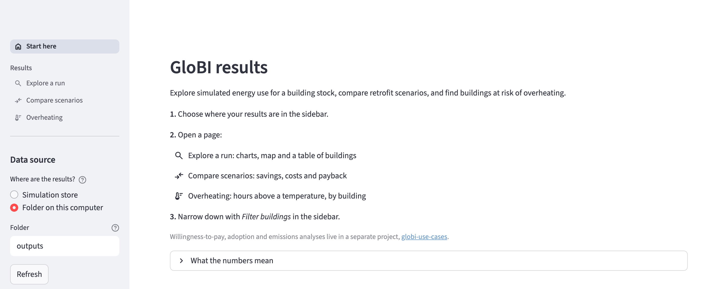

Under **Where are the results?** pick one:

| Option                      | Use it when                                                                                                                                                 |
| --------------------------- | ----------------------------------------------------------------------------------------------------------------------------------------------------------- |
| **Simulation store**        | Your runs went through the GloBI stack. Every finished run is listed, with nothing to download first. The grey badge shows which store you're connected to. |
| **Folder on this computer** | Someone sent you result files, or you fetched them with `get experiment`. Type the folder that holds the run folders (usually `outputs`).                   |

Press **Refresh** when new runs have finished and you want to see them.

### Settings

Open **Settings** in the sidebar to set two things once for every page:

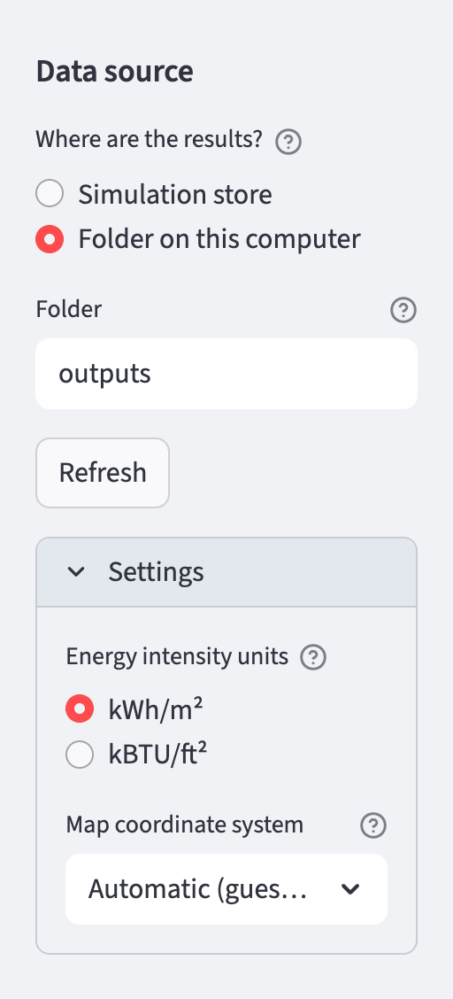

- **Energy intensity units**: kWh/m² or kBTU/ft².
- **Map coordinate system**: leave it on **Automatic**, which guesses from the building footprints. Change it only if buildings appear in the wrong place (see [Troubleshooting](#troubleshooting)).

!!! tip "What the numbers mean"
The **What the numbers mean** box on the Start page explains every energy term the dashboard uses (energy use intensity, peak demand, payback, …). The Overheating page has its own box for overheating terms.

---

## 2. Explore a run

Open **Explore a run** in the sidebar and pick a run from the **Run** list. Runs are named _scenario (version) · experiment_, e.g. `Baseline (v1.2.0) · GloBI_Tutorial`.

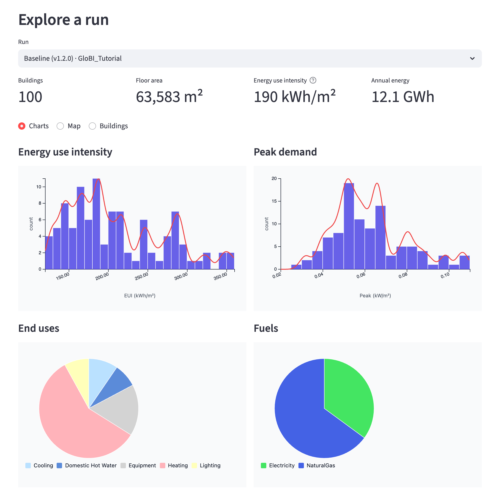

The four numbers at the top summarise the run:

- **Buildings**: how many buildings are included.
- **Floor area**: their total heated or cooled floor area.
- **Energy use intensity (EUI)**: energy used per m² of floor area in a year. Large buildings count for more than small ones, so this is the stock-wide average.
- **Annual energy**: total energy used in a year.

Below them, choose a view: **Charts**, **Map** or **Buildings**. Only the chosen view is drawn, which keeps the page quick on large runs.

**Charts** has:

- how EUI and peak demand are spread across buildings (taller bars mean more buildings at that value);
- what the energy is used for (heating, cooling, lighting, …) and which fuels supply it;
- how both vary month by month.

Hover over any chart to see exact values. **Download charts and data** at the bottom saves every chart (as an interactive web page) and its numbers (as CSV) in one zip.

### Filter buildings

Use **Filter buildings** in the sidebar to focus on part of the stock. Floor area and building age are offered first when the run has them. Add any other attribute (typology, heating system, income, …) from the **Filter by** list.

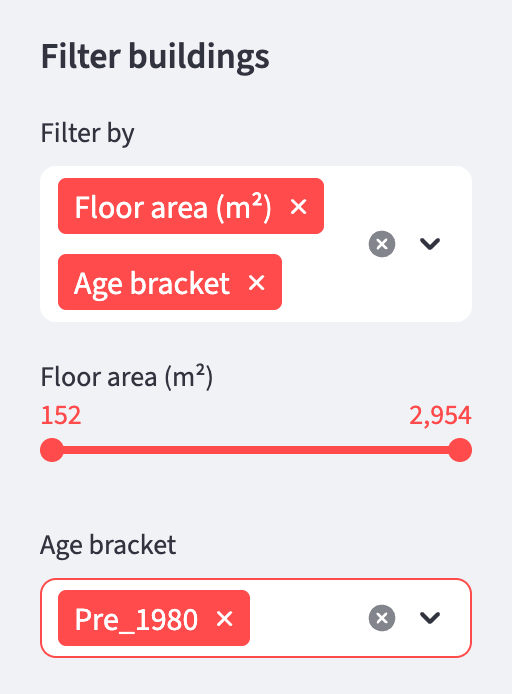

- **Ranges** such as floor area use a slider. Each step is 5% of the buildings, so you can pick "the smallest quarter" even when a few very large buildings exist.
- **Categories** such as age bracket use a list. Leave it empty to include everything.

A grey line under the run name tells you how many buildings are left, e.g. _Showing 32 of 100 buildings_, and the headline numbers update:

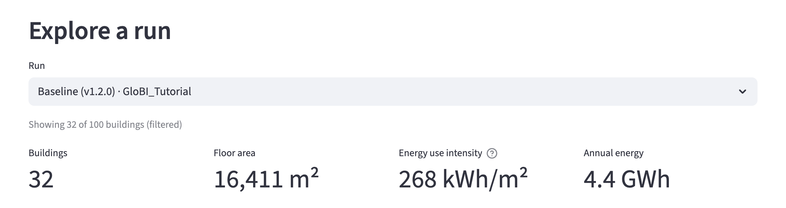

Every number, chart, map and table on the page then uses only those buildings. Filters work the same way on the Compare and Overheating pages.

### Map

The **Map** view shows each building where it stands, coloured by the measure you choose under **Colour by**.

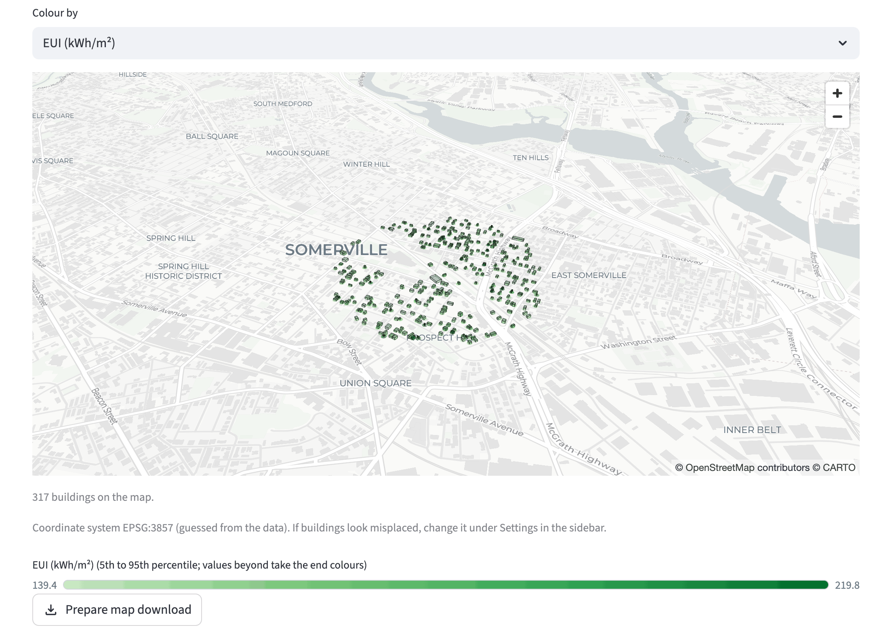

- **Hover** over a building to see its ID and value.
- **Scroll** to zoom. **Drag** to move. **Right-drag**, or Ctrl-drag, to tilt and rotate the 3D view.
- The colour bar under the map shows the range of values. Colours stretch from the 5th to the 95th percentile, so a handful of extreme buildings doesn't wash out the rest.
- The caption says how many buildings are on the map, and how many very large buildings (over 10,000 m²) were left off so they don't hide the rest.
- To save the map, press **Prepare map download**, then **Download map (HTML)**. The file opens in any browser.

If buildings appear in the wrong place, or the map is empty, see [Troubleshooting](#troubleshooting).

### Buildings table

The **Buildings** view lists buildings with the highest EUI first, alongside their attributes.

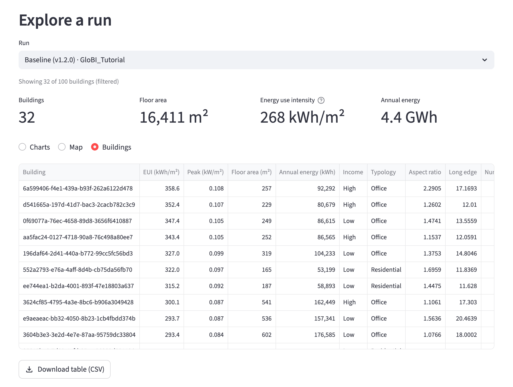

- Click a column header to sort by it.
- Hover over the table and use the magnifying glass in its corner to search, e.g. for a building ID.
- **Download table (CSV)** saves every filtered building, even when the page shows only the first 10,000. The file opens in Excel.

---

## 3. Compare scenarios

Open **Compare scenarios** to see what a retrofit (or any other change) does compared with today's buildings.

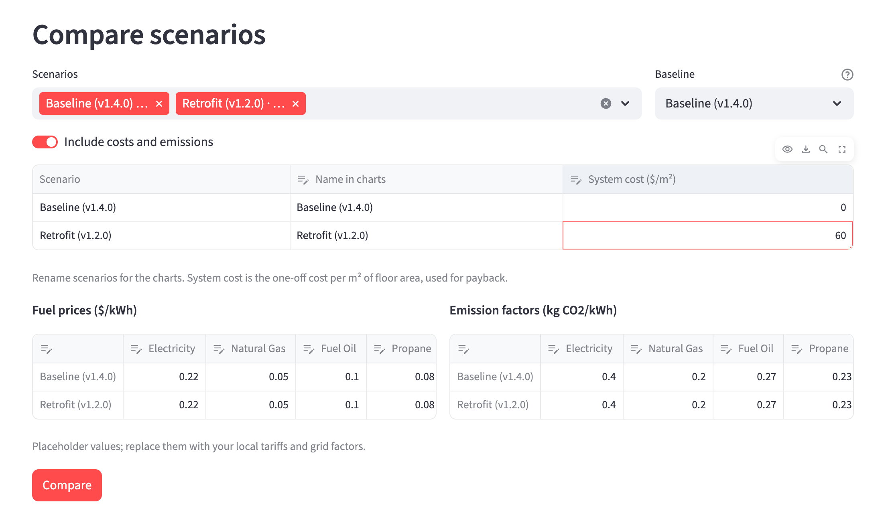

1. Pick two or more runs under **Scenarios**.
2. Choose the **Baseline**: the scenario the others are measured against, usually the current stock.
3. Optionally, give scenarios shorter **names** for the charts in the first table.
4. Optionally, switch on **Include costs and emissions**. Double-click any white cell to change it:
   - **System cost ($/m²)** in the first table: the one-off cost of each scenario per m² of floor area, e.g. what the retrofit costs to install. Leave the baseline at 0.
   - **Fuel prices ($/kWh)** and **Emission factors (kg CO2/kWh)**: one row per scenario, so a scenario can use different tariffs or a cleaner grid. The starting values are placeholders, so replace them with your local figures.
5. Press **Compare**.

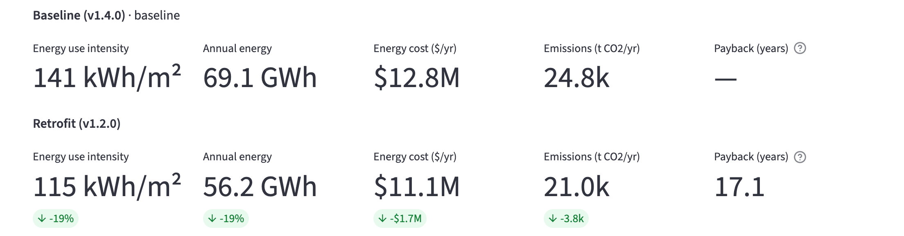

Each scenario gets a row of numbers, and the coloured tags show the change against the baseline. **Green** means lower than the baseline (less energy, cost or emissions); **red** means higher.

**Payback (years)** is how many years the yearly energy-cost savings take to repay the system cost. It shows "—" for the baseline, when no system cost is entered, or when a scenario doesn't save money.

Further down the page:

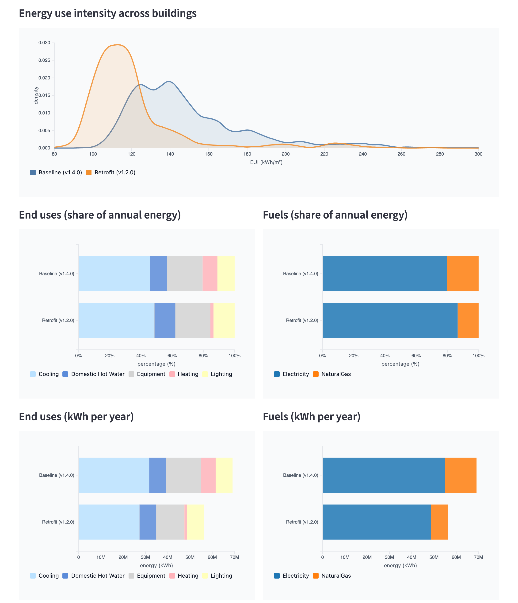

- **Energy use intensity across buildings** overlays each scenario's spread of EUI. A curve further left means buildings use less energy per m².
- **End uses** and **Fuels** show each scenario's mix, first as shares and then in kWh per year. For example, a heat-pump retrofit moves the fuel share from natural gas to electricity.
- With costs switched on, bar charts compare annual energy cost and emissions.
- **Download charts and data** saves all of these, plus a cost and emissions summary table.

At the bottom, a **Map** shows any scenario. With costs on, you can also colour it by annual energy cost, emissions or system cost.

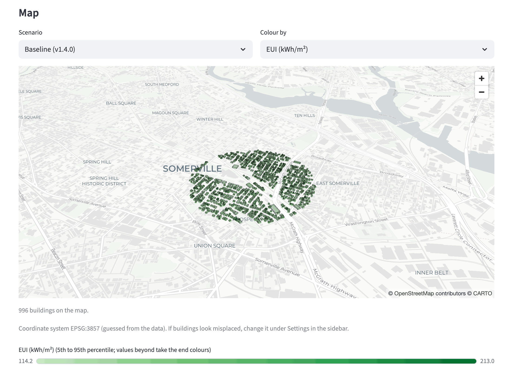

!!! warning "Scenarios with different buildings"
If the scenarios don't cover the same number of buildings, the page shows a warning. Totals (annual energy, cost, emissions) aren't comparable then, because one scenario simply has fewer buildings. Compare energy use intensity instead, or check that the runs used the same building set.

!!! note "About these screenshots"
The Compare and Overheating screenshots use the larger `TestRegion_Tutorial` sample. With the tutorial's own `GloBI_Tutorial` runs the pages look the same.

---

## 4. Overheating

Open **Overheating** to see which buildings get too warm, for how long, where they are, and what they have in common. This page needs runs with overheating results; see [the tutorial](../run-simulations/tutorial.md#d-overheating-and-hourly-outputs) for how to produce them.

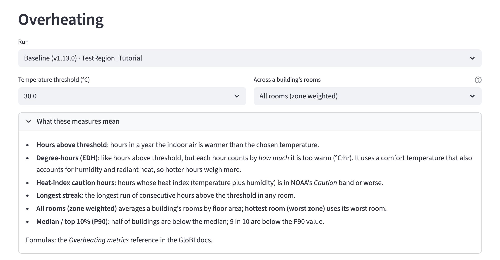

At the top:

- **Run**: only runs with overheating results are listed.
- **Temperature threshold (°C)**: the temperatures the run was simulated with. Everything below is "above this temperature".
- **Across a building's rooms**: buildings have several rooms (zones). **All rooms (zone weighted)** averages them by floor area; **Hottest room (worst zone)** uses the worst room, which matters when a single room can be dangerous.
- **What these measures mean** explains the overheating terms in plain language: hours above threshold, degree-hours (EDH), heat-index caution hours, longest streak, median and P90. For the formulas, see the [Overheating metrics reference](../../reference/overheating_metrics.md).

Then choose a section: **Portfolio**, **Map**, **Priority list** or **Correlations**. Only the chosen section is drawn, so switching is quick even for large stocks.

A run may not include every overheating table. Charts and numbers for a missing table are simply left out.

### Portfolio: how bad is it overall?

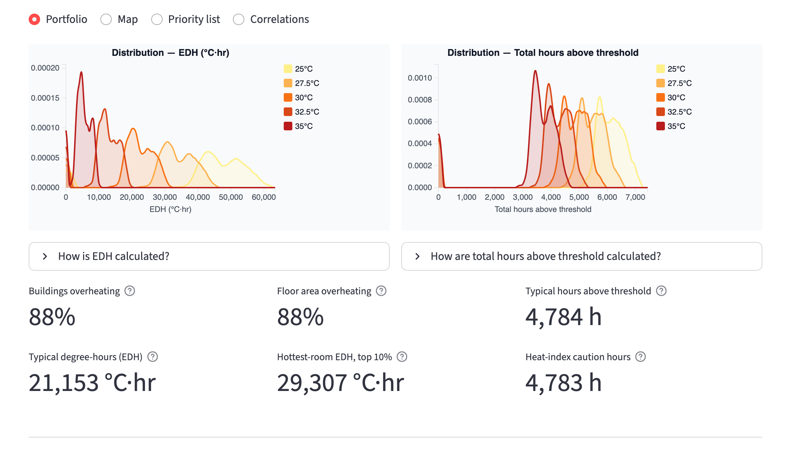

- **Distribution charts at every threshold**: one curve per temperature, from yellow (lowest threshold) to red (highest). Curves moving left as the threshold rises is expected; how far they move shows how sensitive the result is to the threshold you pick. The **How is … calculated?** boxes under each chart give the formula.
- **Headline numbers** for the chosen temperature:
  - **Buildings overheating** and **Floor area overheating**: the share with at least one hour above the threshold.
  - **Typical hours above threshold** and **Typical degree-hours (EDH)**: the median building.
  - **Hottest-room EDH, top 10%**: in each building's worst room; 9 in 10 buildings are below this.
  - **Heat-index caution hours**: average hours per building at NOAA _Caution_ or worse.

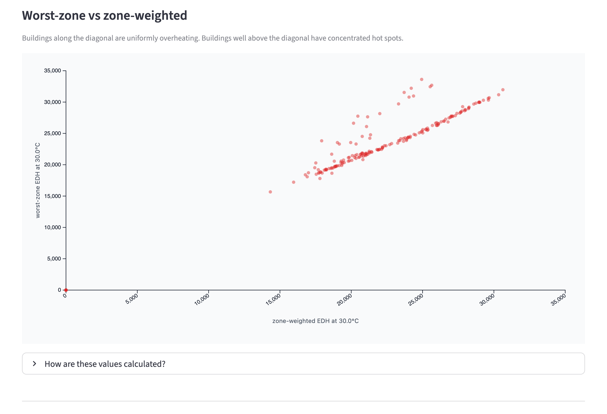

- **Worst-zone vs zone-weighted** (scatter): each dot is a building. Dots on the diagonal overheat evenly across rooms; dots well above it have one or two hot rooms, which a targeted fix (shading, ventilation in that room) may solve.

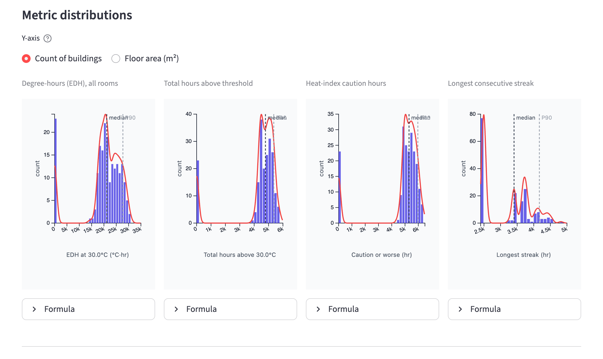

- **Metric distributions**: histograms of each measure across buildings, with the median and P90 marked. Switch **Y-axis** to **Floor area** to see how much floor area, rather than how many buildings, sits in each band.

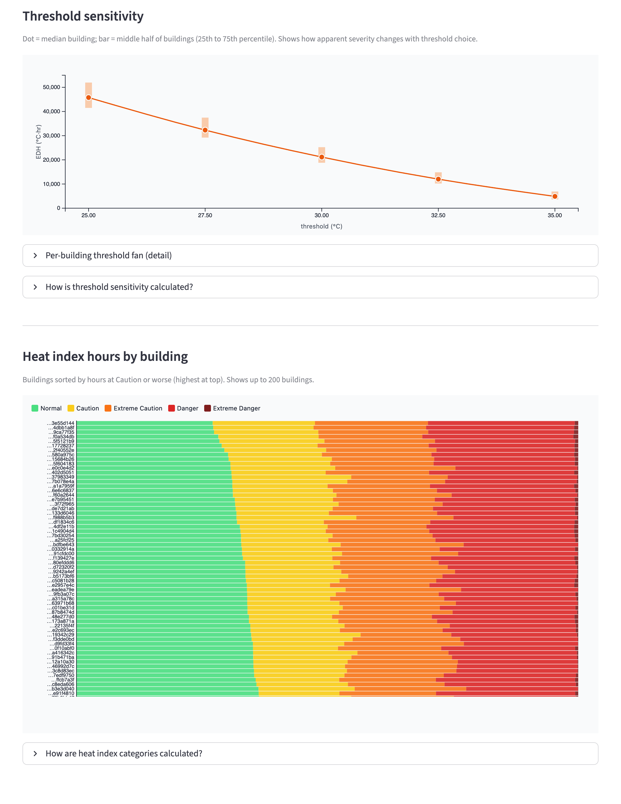

- **Threshold sensitivity**: the dot is the median building and the bar the middle half of buildings (25th to 75th percentile) at each threshold. A steep line means the answer depends heavily on which threshold you report. Open **Per-building threshold fan** to see individual buildings.
- **Heat index hours by building**: one bar per building (up to 200, worst first), split into NOAA heat-index bands from _Normal_ to _Extreme Danger_. Labels show the end of each building ID; hover a bar for the full ID. Scroll inside the chart to see more buildings.

### Map: where are the hot buildings?

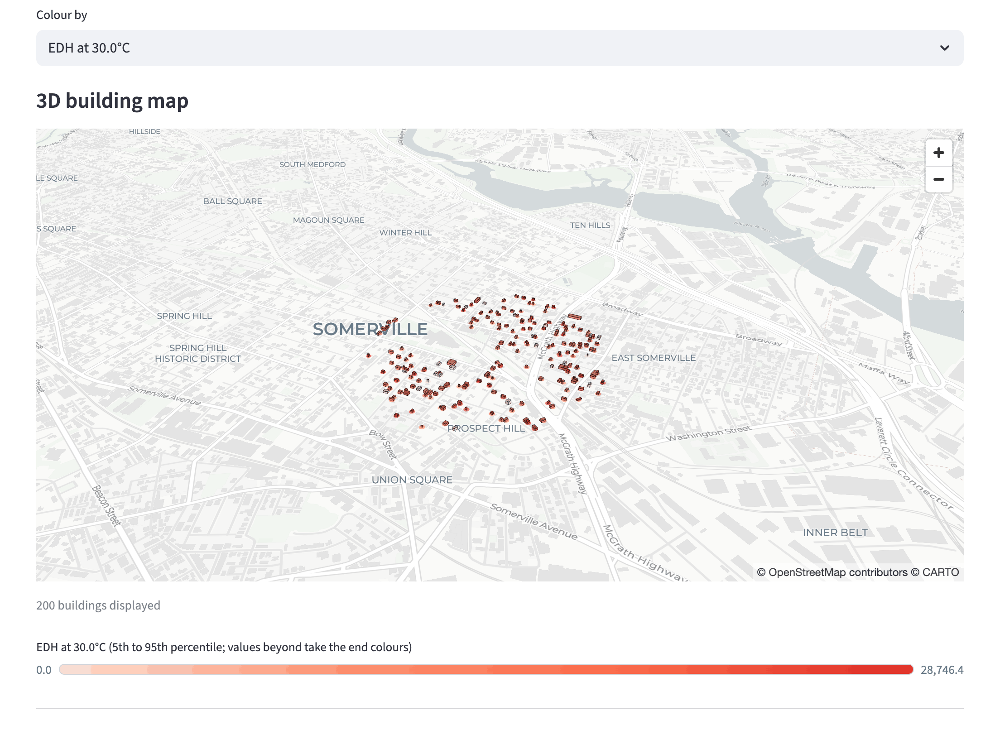

- **Colour by** chooses the measure: degree-hours, hours above the threshold, or heat-index caution hours. The page-level threshold and room setting apply.
- The **3D building map** works like the one on Explore a run: hover for a building's value, scroll to zoom, right-drag to tilt.

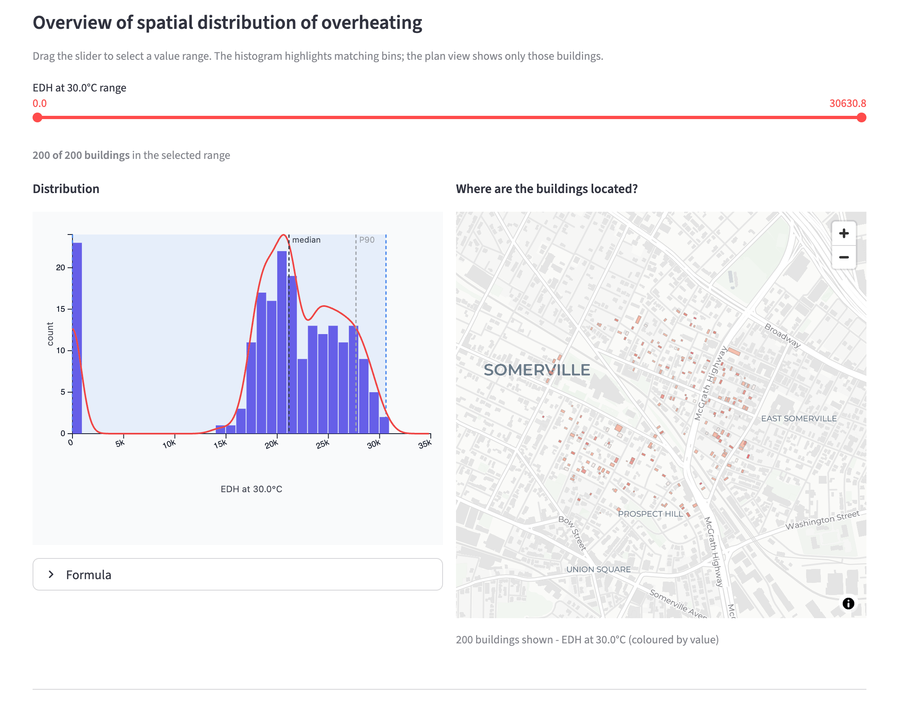

- **Overview of spatial distribution**: drag the slider to pick a range of values. The histogram highlights that range, and the plan view next to it shows only those buildings, e.g. the worst 10%, to see whether they cluster.
- When colouring by something other than hours, a second panel below does the same for **total hours above the threshold**.
- If every building has the same value (for example, none overheats at a high threshold), the page says so instead of showing a slider. Try a lower temperature.

### Priority list: which buildings first?

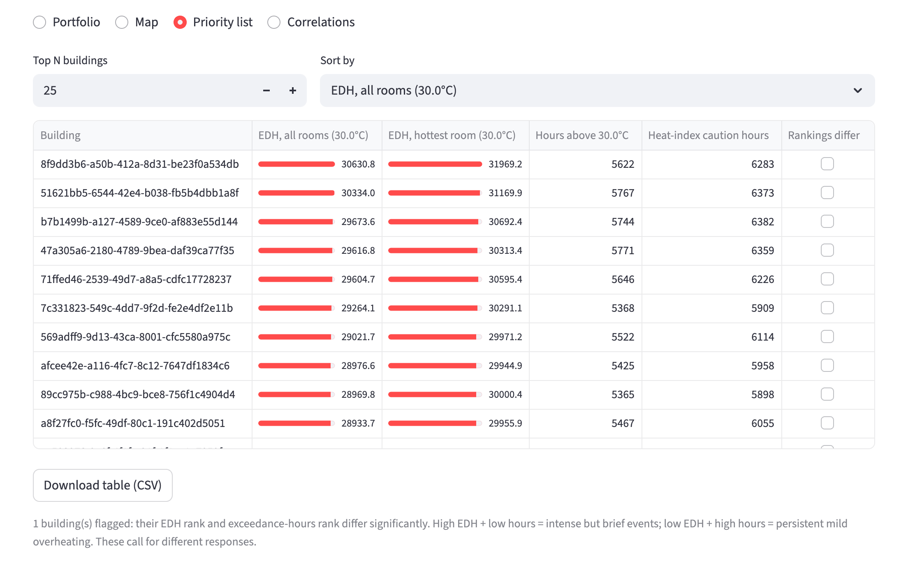

- **Top N buildings** and **Sort by** choose how many buildings to list and by which measure.
- The bars make it easy to compare buildings at a glance.
- **Rankings differ** is ticked when a building ranks very differently by degree-hours and by hours above the threshold. High degree-hours with few hours means short, intense heat; the reverse means long, mild overheating. They call for different fixes, so check these buildings before choosing one.
- **Download table (CSV)** saves the list.

### Correlations: what do hot buildings have in common?

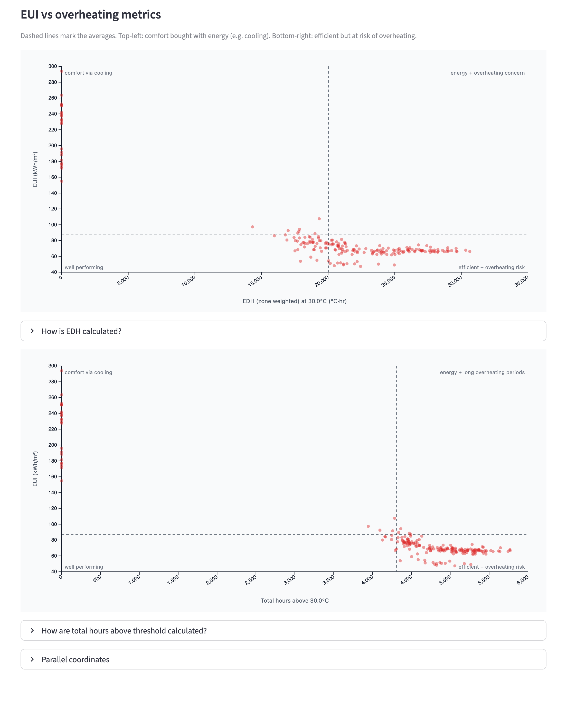

- **Design and overheating risk relationships**: box plots of degree-hours for each building characteristic (e.g. typology, age, wall type). This needs the run's building characteristics file (`buildings.parquet`); without it the page says so and skips these charts.
- **EUI vs overheating metrics**: each dot is a building. The dashed lines mark the averages:
  - **top-left**: low overheating but high energy use, e.g. comfort bought with cooling;
  - **bottom-right**: efficient but at risk of overheating, often the group to watch after a retrofit;
  - **top-right**: both a problem.
- **EDH by number of floors**: whether taller or shorter buildings overheat more.
- **Parallel coordinates** (expand to view): each line is one building across several measures at once, useful for spotting buildings that are bad on everything.

---

## Downloads

| Where                       | Button                                                 | What you get                                                                              |
| --------------------------- | ------------------------------------------------------ | ----------------------------------------------------------------------------------------- |
| Explore a run → Charts      | **Download charts and data**                           | A zip with every chart as an interactive web page (HTML) and its numbers as CSV           |
| Explore a run → Map         | **Prepare map download**, then **Download map (HTML)** | The 3D map as a web page that opens in any browser                                        |
| Explore a run → Buildings   | **Download table (CSV)**                               | Every filtered building with its results and attributes                                   |
| Compare scenarios           | **Download charts and data**                           | A zip with the comparison charts, end-use and fuel totals, and the cost/emissions summary |
| Overheating → Priority list | **Download table (CSV)**                               | The ranked buildings with all their overheating measures                                  |

Downloads always reflect the current filters.

---

## Troubleshooting

Click a problem to see the cause and the fix.

??? problem "No runs are listed"

    **Cause:** with **Simulation store**, the local GloBI stack isn't running (the sidebar shows a red message about reaching the store), or the dashboard was started without the store settings. With **Folder on this computer**, the folder doesn't contain run folders.

    **Fix:**

    1. **Simulation store:** start the stack with `make engine`, then press **Refresh**. If the message says the store isn't configured, start the dashboard with `make viz-native` rather than calling Streamlit directly.
    2. **Folder on this computer:** pick the folder that *contains* the run folders (usually `outputs`). Each run folder needs a results file such as `EnergyAndPeak.pq`.

??? problem "The map is empty or in the wrong place"

    **Cause:** building footprints are stored in a map projection that the result files don't record. The dashboard guesses it from the footprints, and each map's caption says which one it used.

    **Fix:** open **Settings** in the sidebar and, under **Map coordinate system**, pick the projection used when the buildings were prepared, e.g. `EPSG:32619` for eastern Massachusetts in UTM. Use **Other…** to type any EPSG code. Whoever ran the simulations can find it as `cart_crs` in the run configuration.

??? problem "Overheating says there are no runs with overheating results"

    **Cause:** overheating results are only produced when the run's manifest includes an `overheating_config`. With **Folder on this computer**, the overheating tables are not downloaded by default.

    **Fix:**

    1. Use **Simulation store**, which fetches the overheating tables automatically.
    2. Or, with **Folder on this computer**, fetch them yourself, e.g. `make cli-native get experiment -- --run-name <run name> --dataframe-key BasicOverheating`. Repeat with `ExceedanceDegreeHours`, `HeatIndexCategories` and `ConsecutiveExceedances` to get every chart.

??? problem "The page is slow"

    **Cause:** very large runs (around 100,000 buildings) take some seconds to load the first time. Maps of many buildings take longest, because every building is sent to your browser.

    **Fix:** filter to the buildings you care about. After the first load, changing a setting is quick.
